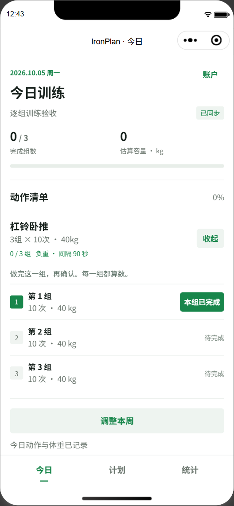
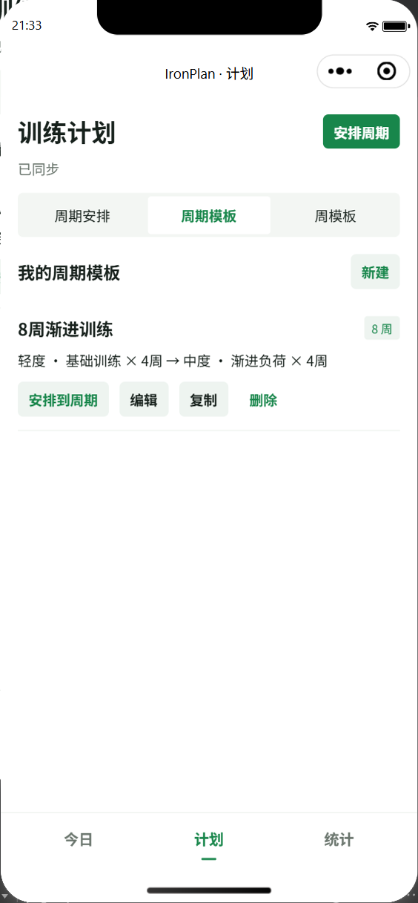
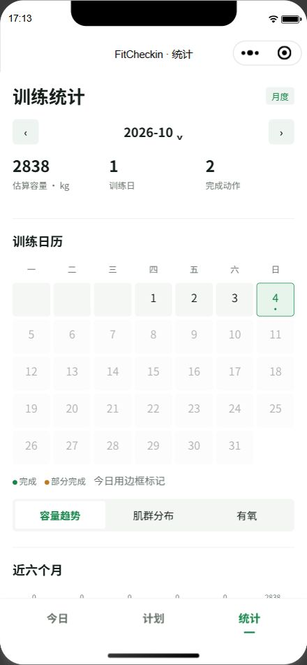

# IronPlan

[](https://github.com/xiongxiansheng050454/FitCheckin/actions/workflows/ci.yml)

项目原名 FitCheckin，现已更名为 IronPlan。现有云函数、数据库与本地缓存继续使用 `fitcheckin` 技术标识，以兼容已部署服务和已保存数据。

原生微信健身打卡小程序：周模板与有限训练周期、逐组训练、月历、估算训练量与分享海报。主包包含今日、计划、统计；管理、历史详情和海报采用分包。

## 项目预览

以下截图来自微信开发者工具联调，使用临时验收数据；部分历史截图仍显示旧名称 FitCheckin。

<table>
  <tr>
    <th>逐组训练</th>
    <th>周期模板</th>
    <th>训练统计</th>
  </tr>
  <tr>
    <td></td>
    <td></td>
    <td></td>
  </tr>
</table>

## 技术与工程亮点

- **原生小程序**：JavaScript、WXML、WXSS 与自定义 Tab Bar，客户端页面无 npm 运行时依赖；管理、历史和分享功能分包加载。
- **训练计划建模**：周模板组成有限周期，已排周期保存独立副本；开始训练后冻结当天动作与体重，更新今日清单时保留已完成的组数和参数。
- **离线同步与冲突处理**：本地持久化队列支持重启后重试；云端通过事务与操作回执实现去重，以版本号检测冲突，用户可以选择冲突处理方式。
- **服务端身份隔离**：CloudBase Event 云函数使用微信运行身份，文档数据库禁止客户端直接读写；数据与缓存按应用、用户及环境隔离。
- **业务与集成验证**：Node.js 内置测试覆盖真实 store、云函数处理器、SDK 序列化和模拟文档事务；PGlite 验证历史 PostgreSQL 迁移，GitHub Actions 自动运行测试与源码检查。

```text
微信小程序页面 → 本地缓存 / 待同步队列 → fitcheckin 云函数 → CloudBase 文档数据库
                   ↑ 离线恢复与冲突处理     ↑ 微信身份校验       ↑ 事务与操作回执
```

## 快速开始

需要 Node.js 18+、微信开发者工具，以及自己的微信小程序 AppID 和 CloudBase 环境。

```powershell
git clone https://github.com/xiongxiansheng050454/FitCheckin.git
cd FitCheckin
npm ci
npm ci --prefix cloudfunctions/fitcheckin --ignore-scripts
npm test
npm run check
```

在微信开发者工具导入仓库根目录。部署到自己的环境时，修改 `project.config.json` 的 `appid`、`miniprogram/lib/environment.js` 的环境 ID，以及 `cloudfunctions/fitcheckin/index.js` 的 `APP_ID` 白名单，再按 [后端部署说明](docs/backend-deployment.md) 创建集合、配置权限和索引并部署云函数。当前仓库保留原项目的非密钥 AppID/环境标识；这些标识不授予访问权限。本地环境回归测试固定验证原配置，修改配置后需要同步调整相关测试断言。

普通测试使用本地模拟或嵌入式数据库，无需云凭证。原生编译需本机安装微信开发者工具；GitHub CI 不运行原生编译或云端部署。`project.private.config.json`、依赖目录和凭证文件已通过 `.gitignore` 排除。首次云端身份确认需要联网。

## 目录结构

```text
miniprogram/              小程序页面、分包与业务模块
cloudfunctions/fitcheckin/ 云函数、校验与文档数据库访问
tests/                   业务、页面、同步及后端回归测试
scripts/                 项目检查、包体积及原生验收工具
docs/                    界面截图、部署与验收记录
cloudbase/migrations/     历史 PostgreSQL 迁移（当前后端不使用）
```

## 产品行为

使用场景为健身房，不接入户外定位或运动手表。力量预设不指定重量，用户填写自己的训练重量；强度统一使用 RPE，力量/自重为0–10（10−RIR），有氧为6–20。编辑页的灰色圆圈问号解释刻度，滑杆旁显示剩余次数或呼吸/说话感受。跑步机、跳绳等有氧按分钟及RPE安排，不提供距离、速度或跳绳次数。既有记录保留原始参数。

首次使用且尚未填写体重时，今日页弹出体重输入及隐私说明；可保存或暂时跳过，之后可通过右上角「我的」按钮修改。提示状态按微信用户和云环境保存在本机，已有体重不再提示。体重仅用于个人训练记录与容量估算，不会向其他用户公开；保存先落盘，再通过现有队列同步。

在「周模板」中定义轻度、中度等训练周，进入「周期模板」分别添加4周轻度和4周中度，保存为可反复使用的8周模板。点击「安排到周期」一次安排完整8周，默认接在最后一个已排周期之后；也可直接编辑周期并「存为周期模板」。支持从本周或未来一周开始、调整未来周顺序及模板、提前续排；到期不会自动循环。周期模板使用周模板的最新参数，已排周期保存独立副本，改动模板不会影响它；本周已有训练记录保持不变。详情见 [周期安排与验收](docs/cycles-testing.md)。

## 本地检查

需要 Node.js 18 或更高版本。核心业务和页面没有客户端 npm 依赖。

```powershell
npm test
npm run check
npm run check:native -- --devtools "E:/wx_project/微信web开发者工具"
```

`check` 检查页面文件、引用、事件、JavaScript/JSON及源码包体积。`check:native` 使用本机微信开发者工具的原生 WXML/WXSS 编译器；可通过参数或 `WECHAT_DEVTOOLS_ROOT` 指定安装目录。

包体积限制为主包及每个分包最多2MB、合计最多30MB，开发预算为每包1.5MB、合计6MB。源码检查超过硬限制时返回非零状态；上传前仍必须检查微信开发者工具的实际代码包分析。QuickStart 小程序示例和图片已清理。2026-10-06 超级组版本微信预览实际包大小：主包128,773字节、管理分包54,620字节、历史分包2,462字节、分享分包6,457字节，总计192,312字节。

## 云端配置

目标 AppID：`wxe25930a2cdce35d0`；环境：`weixing2-d7g2j6asyc5132905`。首次使用需要联网，由云函数确认微信身份；以后支持本地缓存和待同步队列。业务缓存、待同步队列和庆祝标记按环境及微信用户隔离；旧环境缓存保留，不自动迁移或重放。

后端已改用文档型数据库，通过云函数运行身份访问，不再需要 PostgreSQL API Key。导入当前目录至微信开发者工具，并按 [后端部署说明](docs/backend-deployment.md) 配置两个集合、禁止客户端读写的权限及组合索引，然后部署 `fitcheckin` Event 云函数。文档数据库的共享实例规格在控制台选择；未来多个小程序共用此环境时，还需要各 AppID 的环境授权，并使用各应用独立的云函数和集合。

已确认新环境关联当前 AppID，文档型云函数已部署，两个集合已禁止客户端读写，组合索引已创建。新环境原生联调通过云端读写、去重、冲突检测、身份校验、今日页同步及官方小程序码生成；完整证据见 [执行记录](docs/progress.md)。云环境必须可被当前小程序使用，若在腾讯云控制台创建环境，需在微信开发者工具云开发控制台中使用已有环境，并完成相关账号及小程序关联。

本机 CloudBase MCP 已配置到新环境，管理凭证只保存在 Windows 用户环境变量 `CLOUDBASE_API_KEY`，不放入项目或业务云函数。重启 Codex 后标准 MCP 连接会加载本地配置；本次已通过本地 MCP 验证管理访问。

## 记录规则

- 周模板组成有限周期，可为指定周设置覆盖；未安排首个周期前兼容旧周循环，周期结束后不再循环。点击开始训练后冻结当天动作和体重。
- 点击动作的“开始”展开每组，实际完成后点击该行或“本组已完成”；每组按计划参数记入容量，全部组数完成才标记动作完成。只能撤销最后完成的一组，历史日期只读。
- 动作库的“超级组”将2至10个动作组合成一个条目，可分别编辑参数，统一设置组数和整组休息。训练时整组确认一次，容量及肌群按内部动作汇总；组内没有额外确认或倒计时。
- 组间休息使用原生全屏界面，显示下一组、累计容量、组数与轮换鼓励文案，到时短震动，可提前结束休息。动作最后一组完成后直接结束该动作；今日全部完成后弹出庆祝。休息结束时间按用户和环境保存在本机，切出、返回或重启后按时间戳计算；过时显示鼓励文案。切出期间不在后台震动，回来后提示一次。前台休息时保持屏幕亮起。
- 负重容量为重量×次数×组数，自重容量为体重×系数×次数×组数；系数和肌群分配均为估算。
- 有氧时长和距离单独统计，不并入公斤容量或肌群百分比。
- 多设备冲突保留本地修改，可选择重新应用或采用云端版本；不同日计划快照不能相互覆盖。
- 当日已经开始后，修改周安排不会自动覆盖快照；今日页会显示「更新今日清单」。确认后保留有完成组数的动作、参数与进度，加入新安排的动作；全部撤销时可替换原清单。历史日期仍只读。
- 今日最后一组完成后自动显示原生庆祝弹窗并短震动，同时后台准备海报；按钮在今日页直接打开海报遮罩。连续打卡跳过计划休息日，完成至少一组即计为训练日，只在过去有安排但完全未练时中断；七次连续达成有特别反馈。历史安排随设置同步，早期缺少历史安排时明确标注按现有计划估算。
- 统计页可生成所选月份的海报。海报突出训练容量，提供5条可切换文案，月度肌群使用彩色环图，包含IronPlan名称和官方小程序码，支持预览、保存到相册与分享图片。正式版码面向其他用户的扫码打开需在发布后验收；首次获取官方码需要联网，后续可使用缓存。

实现契约见 [implementation-contract.md](docs/implementation-contract.md)，执行状态与未验证事项见 [progress.md](docs/progress.md)。
